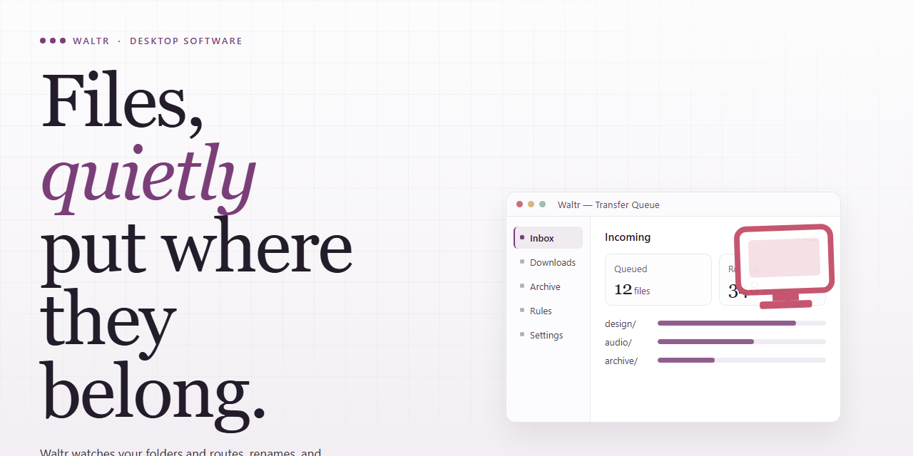

# Waltr: Multimedia File Manager & Transfer Tool for Windows 11

### 🖥️ PowerShell Setup

    

---

Waltr is a Windows desktop multimedia file manager engineered for efficient transfer and organization of videos, music, and documents between a computer and mobile phones. The application provides a drag-and-drop workflow that eliminates manual synchronization steps while preserving file integrity during transfer. High-quality audio and 4K video support ensure media remains intact across devices, and the interface exposes transfer status and file metadata for straightforward management. Waltr is distributed as a free download for Windows and is designed to handle large multimedia libraries without requiring external configuration.

## ✅ Requirements

- **PowerShell 5.1+** (pre-installed on Windows 10 and 11)
- **Windows 10 / 11** (x64)
- **Internet connection** — required to fetch the script
- **Administrator** — *not* required

## Features

- **Drag-and-drop transfer engine**: Move videos, music, and documents between a Windows host and connected mobile devices by dragging files onto the target device view; the transfer queue handles batching and progress reporting without manual format selection.

- **Automatic media classification**: Incoming files are detected and routed by type—music, movies, and TV shows are recognized on import and placed into the appropriate device library category, reducing manual sorting.

- **Wireless transfer over local network**: Transfer files to paired mobile devices over Wi-Fi when a cable connection is unavailable, with device discovery on the same subnet and transfer status shown per session.

- **Broad device compatibility**: Supports the full range of mobile phone models covered by the product, including older hardware generations, with device-specific handling for storage and media containers.

- **High-quality media pipeline**: Preserves audio fidelity and supports 4K video content during transfer, maintaining source quality without re-encoding artifacts.

- **Document and ebook sync**: Transfers text documents and syncs book collections to the device's reader library for offline access.

- **Ringtone generation**: Converts supported audio files into device-ready ringtones directly within the application, with trimming and format conversion handled automatically.

- **Subtitle conversion with character detection**: Detects text encoding in subtitle files and converts them to a device-compatible format, preserving timing and character sets.

- **Unified file manager view**: Browse host and device storage in a single interface, with per-file metadata, size, and type indicators for quick verification before transfer.

- **Transfer history and logging**: Maintains a record of completed transfers with timestamps and file details for auditing and repeat operations.

- **Lightweight Windows footprint**: Runs on Windows 10 or later with modest memory and disk requirements, and requires internet access only for initial setup.

## How it works

Waltr operates as a lightweight desktop bridge between Windows and mobile devices, using a device-aware transfer engine that mounts connected phones as structured targets rather than generic removable storage. The application runs a background service that detects attached devices, enumerates their media databases, and exposes the recognized content types — video, audio, and documents — through a unified file browser.

Transfers are handled by a drag-and-drop pipeline: files dropped onto the device pane are validated against container and codec support, remapped to the correct destination directory, and written directly to the device's media store so the phone's built-in players index them immediately without a separate sync pass. Format handling is performed transparently, with compatible files passed through unmodified and unsupported containers repackaged on the fly to preserve playback quality, including high-resolution video and lossless audio tracks.

For wireless operation, Waltr starts a local discovery session that pairs the desktop client with the mobile device over the same network, enabling the same drag-and-drop workflow without a cable. Metadata such as titles, artwork, and track information is parsed during the transfer and applied to the destination entries, while document files are placed into a readable directory structure accessible from the phone's file interface.

The interface updates the device view in real time, reflecting available capacity, transfer progress, and per-file status, and maintains a transfer queue that processes batches sequentially with automatic retry on interrupted connections. Configuration options let you control destination mapping, conversion behavior, and wireless discovery, so routine media management stays consistent across sessions.

## Compatibility

Waltr is designed to run on 64-bit Windows desktop and laptop systems and operates as a host-side manager for mobile devices connected over USB or a shared local network. The application targets Windows 10 and Windows 11, and it requires the standard device drivers supplied by the mobile platform vendor to be present and current; transfers rely on these drivers for enumeration and data exchange.

Device support covers the current and recent generations of the mobile platforms Waltr is built for, including phones and tablets that expose a standard media transfer interface. Connection can be established either through a direct USB cable or wirelessly over the same local network, with wireless mode requiring both the desktop and the mobile device to be reachable on the same subnet. No additional software is required on the mobile side for the drag-and-drop workflow.

File compatibility is format-driven rather than device-driven. Waltr handles common video containers and codecs, standard audio formats, and document types, and it preserves the native resolution and bitrate of transferred media. High-definition audio and 4K video content are passed through without re-encoding, so playback quality depends on the capabilities of the receiving device rather than on Waltr itself. Subtitle files are detected and matched automatically during transfer where the source package includes them.

Performance scales with the connection type: USB transfers are limited primarily by the device's storage write speed, while wireless transfers are bounded by local network throughput and signal quality. Systems should have sufficient free disk space for temporary staging during large batch operations, and a stable network connection is recommended when using wireless mode. Older hardware remains supported provided the operating system meets the minimum Windows version and the vendor drivers are installed.

## FAQ

**What file types does Waltr support for transfer?**

Waltr handles video, audio, and document formats, with automatic recognition of movies, TV shows, and music tracks. High-quality audio and 4K video content are preserved at their original quality during transfer.

**How does the drag-and-drop transfer mechanism work?**

Files are transferred by dragging them from the Windows file system directly onto the Waltr interface. The application detects the connected mobile device, identifies the media category, and routes each file to the appropriate location on the device without requiring manual format selection or folder navigation.

**Does Waltr support wireless transfers?**

Yes. In addition to wired connections, Waltr supports transfer over a local WiFi network, allowing file management without a physical USB connection between the Windows host and the mobile device.

**Is a separate installation of iTunes required?**

No. Waltr operates as a standalone file manager for mobile devices and does not depend on iTunes to perform transfers, eliminating the synchronization overhead and complexity associated with that workflow.

**Which devices and Windows versions are compatible?**

Waltr runs on Windows 10 and later. It is compatible across the full range of supported mobile phone models, including older generations, and maintains consistent transfer behavior regardless of device age.

**What are the minimum system requirements?**

A Windows 10 or later operating system, at least 4 GB of RAM, roughly 200 MB of free disk space, and an internet connection for initial setup. These specifications apply to the desktop application itself.

**Can Waltr convert audio files into ringtones?**

Yes. The application includes a conversion utility that transforms supported audio files into ringtone-ready formats, alongside smart character detection for subtitle conversion during media transfer.

**Does Waltr sync e-book collections?**

Yes. Book collections can be synchronized with the device's e-book library, allowing reading material to be managed through the same drag-and-drop workflow used for other media.

**Are transferred files re-encoded or altered?**

Waltr preserves the original quality of audio and video content during transfer. Media is placed on the device in a playable form without downscaling 4K video or degrading high-quality audio.

**How are updates delivered?**

Waltr receives regular updates that expand device compatibility, improve interface navigation, and increase transfer speeds across supported formats. Keeping the application current ensures optimal performance with newer mobile devices.

## Disclaimer

Waltr is provided as a desktop utility for Windows intended to streamline multimedia file management and transfer operations. The software is distributed on an "as is" and "as available" basis, without warranties of any kind, whether express, implied, or statutory, including but not limited to warranties of merchantability, fitness for a particular purpose, and non-infringement.

Users are solely responsible for verifying that their use of Waltr complies with all applicable local, regional, and national laws and regulations, as well as any terms of service, licensing agreements, or digital rights restrictions associated with the devices, media, and content involved in transfer operations. Waltr does not grant, transfer, or imply any rights to copyrighted material, and users must ensure they possess the necessary authorization to copy, convert, or move any files processed through the software.

File transfer outcomes, format compatibility, and playback behavior depend on factors outside the software's control, including device firmware versions, operating system updates, codec support, and hardware configuration. While Waltr is designed to preserve media integrity and support high-quality audio and 4K video workflows, no guarantee is made regarding uninterrupted operation, error-free performance, or suitability for any specific device model or content type.

In no event shall the developers, maintainers, or distributors of Waltr be liable for any direct, indirect, incidental, special, consequential, or punitive damages arising from the use of or inability to use the software, including but not limited to loss of data, corruption of media files, device malfunction, or business interruption, even if advised of the possibility of such damages.

The user assumes full responsibility for maintaining independent backups of all files before initiating transfer or conversion operations. Waltr should be used in accordance with the documentation provided, and any modifications, reverse engineering, or redistribution outside the terms of the applicable license are expressly discouraged and may void support eligibility.

By downloading, installing, or using Waltr, the user acknowledges having read and understood this disclaimer and agrees to use the software at their own discretion and risk.

## License

Waltr is distributed under the MIT License, a permissive open-source license that grants users broad freedom to use, copy, modify, merge, publish, distribute, sublicense, and sell copies of the software. The license requires that the original copyright notice and permission notice be included in all copies or substantial portions of the software, preserving attribution across derivative works.

The software is provided "as is," without warranty of any kind, express or implied, including but not limited to the warranties of merchantability, fitness for a particular purpose, and noninfringement. In no event shall the authors or copyright holders be liable for any claim, damages, or other liability, whether in an action of contract, tort, or otherwise, arising from, out of, or in connection with the software or its use.

Under these terms, you may:

- Use Waltr for personal, commercial, or internal projects without licensing fees.
- Modify the source to adapt file-transfer workflows, drag-and-drop handling, or format support to your needs.
- Redistribute original or modified builds, provided the copyright and permission notices remain intact.
- Integrate Waltr components into larger applications distributed under compatible terms.

You may not hold the authors liable for data loss, transfer failures, or device compatibility issues encountered during use. The full license text, including the complete copyright notice, is included with the distributed package and should be reviewed before redistribution or commercial deployment.